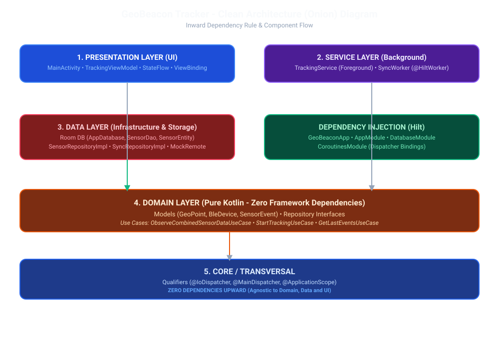

# GeoBeacon Tracker

GeoBeacon Tracker es una aplicación Android desarrollada en **Kotlin** bajo los principios de **Clean Architecture**, diseñada para la captura en segundo plano de ubicación GPS y escaneo de dispositivos BLE (Bluetooth Low Energy), persistencia local reactiva con Room y sincronización periódica garantizada con **WorkManager**.

---

## 🚀 Cómo Compilar y Ejecutar

### Requisitos
- **Android Studio** (Hedgehog o superior recomendado).
- **JDK 17**.
- **Android SDK** (Compile SDK / Target SDK: 34, Min SDK: 26).

### Pasos
1. Clonar o abrir el proyecto en Android Studio.
2. Sincronizar el proyecto con Gradle (`File > Sync Project with Gradle Files`).
3. Ejecutar las pruebas unitarias:
   ```bash
   ./gradlew testDebugUnitTest
   ```
4. Compilar e instalar la app en un emulador o dispositivo físico (API 26+):
   ```bash
   ./gradlew assembleDebug
   ```

---

## 🏛️ Decisiones de Arquitectura (Clean Architecture)

El proyecto respeta estrictamente la **Regla de Dependencia** apuntando siempre hacia el centro (Dominio):



1. **Capa de Dominio (`domain/`)**:
   - Modelos puros de negocio (`models/`: `GeoPoint`, `BleDevice`, `SensorEvent` componiendo `GeoPoint`).
   - Contratos de repositorios (`repositories/`) y Casos de Uso (`usecases/`).
   - **Cero dependencias** de Android, Room o frameworks de Inyección de Dependencias (los Qualifiers residen en `core/`).

2. **Capa de Datos (`data/`)**:
   - Base de datos Room (`AppDatabase`, `SensorDao`, `SensorEntity` gestionando el estado de persistencia `synced`).
   - Mappers bidireccionales (`SensorMapper.kt`) para transformar Entity ↔ Domain.
   - Implementaciones de repositorios (`SensorRepositoryImpl`, `SyncRepositoryImpl`) y fuente de datos remota (`MockRemoteDataSource`).

3. **Capa de Presentación y Servicios (`presentation/` y `service/`)**:
   - `TrackingViewModel` con estado reactivo `StateFlow` (`SharingStarted.WhileSubscribed(5000)`).
   - `TrackingService` (Foreground Service) configurado con tipos de servicios en primer plano para ubicación (Android 14 API 34+) e integrado con WorkManager.

---

## 🌊 Justificación sobre la Combinación de Flujos (Manejo del Hardware)

El principal reto técnico del desarrollo con hardware real es la asincronía. Mientras el escáner BLE puede emitir ráfagas de dispositivos casi de inmediato, el sensor GPS a menudo requiere de varios segundos para fijar su primera posición (el conocido "GPS Cold Start").

Para orquestar esta combinación en el caso de uso `ObserveCombinedSensorDataUseCase`:
- **La Solución (Búfer en Memoria)**: En lugar de utilizar operadores estándares como `combine` o `flatMapLatest` —los cuales perderían emisiones rápidas del BLE mientras esperan al GPS— se optó por usar `channelFlow` implementando un búfer local (`mutableListOf`). 
- **Cero Pérdida de Datos**: Durante el arranque en frío del GPS, los dispositivos BLE detectados no se descartan ni saturan los hilos del sistema (previniendo *backpressure*); en cambio, se acumulan en el búfer. En el instante exacto en que el GPS entrega la primera coordenada válida, el búfer completo es volcado hacia la base de datos (Room) asignándoles esa posición, para luego seguir emitiendo en tiempo real.
- **Testabilidad Asíncrona**: Para demostrar la robustez de esta decisión, se implementaron pruebas unitarias avanzadas utilizando `runTest` y `Turbine`, simulando latencias intencionales en la emisión del flujo simulado del GPS.

---

## 🔄 Sincronización con WorkManager

- **Por qué WorkManager**: Para garantizar que la sincronización de eventos pendientes con el servidor no dependa exclusivamente de ciclos temporales manuales y respete el estado del dispositivo.
- **Implementación**: `SyncWorker` (anotado con `@HiltWorker` y `@AssistedInject`) procesa registros pendientes de Room, los sube mediante `SyncRepository` y solo marca los IDs como sincronizados tras un éxito rotundo.
- **Configuración**: Tarea periódica única (`enqueueUniquePeriodicWork`) configurada a 15 minutos, con estrictas restricciones de red (`NetworkType.CONNECTED`) provistas por el SO de Android.

---

## 🤖 Historial de Desarrollo (AI Collaboration)

Para demostrar el uso maduro de asistentes virtuales en el proceso de desarrollo y arquitectura, los prompts y directrices exactas que dictaron la evolución de este proyecto (dividido en 6 fases iterativas) se han documentado y se encuentran disponibles para su evaluación en el directorio raíz `.ai-history/`.
